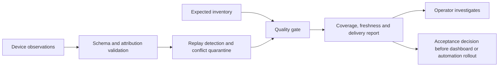

# Telemetry quality gate

A small, runnable architecture demonstration: decide whether device telemetry is reliable enough to support operational decisions.

The scenario is fictional. Two brands share a monitoring platform, and six expected devices emit timestamped observations. A dashboard that uses only arrival time can make stale devices look healthy. Missing devices can disappear entirely unless an independent inventory defines expected coverage. This gate makes both problems visible before downstream dashboards or automation use the data.

**Purpose:** demonstrate requirements discovery, data contracts, failure analysis, acceptance tests and a reproducible customer demonstration. It is a learning project, not production software or an employer implementation. All names and fixtures were created for this demonstration. Implementation and documentation were prepared with AI assistance.

## Run it

Requires Python 3.9 or later, with no third-party packages or external services.

```sh
python3 gate.py --inventory fixtures/inventory.json --events fixtures/events.jsonl --now 2026-01-15T12:00:00Z --json-out local-report.json
python3 -m unittest -v
```

The first command intentionally exits **1** because the demonstration contains faults. It still prints the report and writes `local-report.json`. The tests exit **0** when successful. Do not join these commands with `&&`, because the expected failure would skip the tests.

The fixed timestamp makes the demonstration independent of today's date. Compare with the committed [text report](demo/expected-output.txt) and [JSON report](demo/expected-report.json).

| Measured fixture result | Count |
| --- | ---: |
| Nonblank input records | 11 |
| Accepted unique observations | 4 |
| Exact replays ignored | 1 |
| Conflicting records quarantined | 2 |
| Invalid records rejected | 4 |
| Healthy / degraded / unknown devices | 2 / 1 / 3 |
| Latest device observations over the delivery budget | 2 |

These are synthetic fixture counts. They do not establish real-world savings, incident reduction or enterprise scale.

## Where it fits



The CLI reports acceptance results; it does not forward records to a monitoring product or deploy anything. Equivalent checks could sit in a collector, stream processor, periodic reconciliation job or dashboard query. Central processing only pays off when several consumers need the same contract. An extra processing hop introduces its own delay, ownership and failure modes.

## Contract and decisions

- **Expected inventory is independent of arriving data.** Device IDs are globally unique. Brand and site attribution must match inventory. A stale or incomplete inventory can itself cause false rejection, so reconciliation is a separate requirement.
- **Observation time determines freshness.** Receipt time measures delivery delay. All timestamps require timezones and are normalized to UTC. Up to five seconds of clock skew are tolerated; small negative ages/delays are clamped to zero. Larger future timestamps or observation-after-receipt violations are rejected.
- **Only fresh explicit `error` observations mean degraded.** Missing data, stale data and conflicting latest observations mean unknown. `healthy` means a fresh `ok` signal for this device, not proof of end-to-end business availability.
- **Replay protection is deterministic.** Event IDs are assumed globally unique across devices and producers. Valid events sharing an ID and normalized required fields collapse to one observation. Conflicting valid payloads sharing an ID are all quarantined. `received_at` is part of that fingerprint: it is the original collector receipt timestamp and must survive replay. Re-receiving the same source event with a changed receipt timestamp is therefore a conflict under this contract. A production design must agree on immutable identity and receipt semantics first. Added fields are ignored, not forwarded.
- **Latest observation wins, not latest arrival.** An old error arriving late cannot replace a newer good observation. Different IDs with the same latest observation timestamp but conflicting statuses produce unknown.
- **Fleet state and acceptance are separate.** Fleet state prioritizes fresh explicit errors, then unknown coverage, then healthy. The gate passes only when every expected device is healthy, no invalid/conflicting records remain, and every latest delivery meets the budget. Exact replays alone do not fail it.
- **Budgets are illustrative.** This fixture uses 300 seconds per-device freshness and a 60-second delivery budget, adjustable with `--delivery-budget`. A single snapshot is not a measured production SLO or uptime percentage.

Exit codes: `0` means the quality gate passed; `1` means observations were evaluated but failed acceptance; `2` means unreadable input or invalid configuration. Record-level errors appear in the report. Invalid inventory fails the run because coverage cannot be established.

## Technical boundaries

This is a finite-batch evaluator, not a streaming service. It holds events in memory, has no persistence, authentication, backpressure, retries, watermarking or cross-run deduplication. It cannot prove that a device's self-reported status is accurate. Inventory correctness, source authentication, clock synchronization and business-level synthetic checks remain external responsibilities.

Before production, define traffic volume and recovery requirements, introduce durable event identity and bounded retention, measure late arrivals, establish alert ownership, and load-test representative payloads. Keep raw rejected records in an access-controlled store with a retention policy; this demo outputs reason codes and line references only.

Read the [five-minute demonstration](DEMO.md) and [discovery and acceptance notes](DISCOVERY.md) for the customer-facing explanation and rollout decisions.
